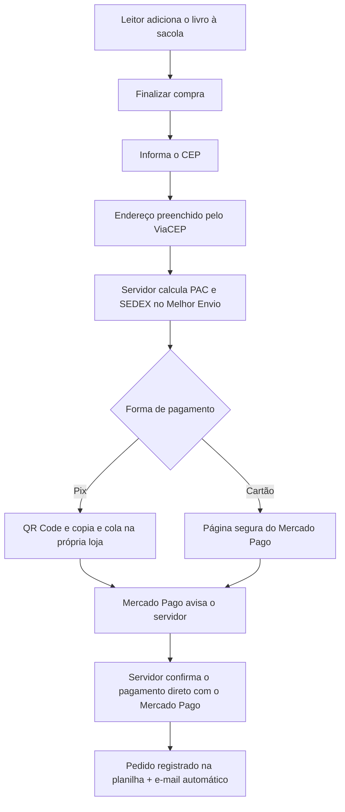

# Loja "Do Zero ao Possível"

> **A pergunta central:** como um autor independente pode vender o próprio livro físico pela internet, com frete calculado e pagamento por Pix ou cartão, sem depender de um marketplace?

Loja on-line para a venda do livro **"Do Zero ao Possível!"**, de Ivan de Souza Dutra. É um e-commerce completo em uma página: apresenta o livro e o autor, calcula o frete pelo CEP e recebe o pagamento por **Pix** (com QR Code na própria página) ou **cartão**.

**Site no ar:** https://loja-do-zero-ao-possivel-sfp2.onrender.com

| | |
|---|---|
| **Cliente** | Autor independente (projeto real, publicado com autorização) |
| **Tipo** | E-commerce de produto único |
| **Pagamento** | Pix e cartão (Mercado Pago) |
| **Frete** | PAC e SEDEX (Melhor Envio) |
| **Status** | No ar e em uso |

---

## Índice

1. [O desafio](#o-desafio)
2. [Telas](#telas)
3. [Como uma compra funciona](#como-uma-compra-funciona)
4. [Funcionalidades](#funcionalidades)
5. [Decisões e por quê](#decisões-e-por-quê)
6. [Cuidados técnicos que precisei resolver](#cuidados-técnicos-que-precisei-resolver)
7. [Tecnologias](#tecnologias)
8. [O que tem neste repositório](#o-que-tem-neste-repositório)
9. [O que aprendi](#o-que-aprendi)

---

## O desafio

O autor queria vender o livro direto ao leitor, com a mesma confiança de uma loja grande: frete real até a casa da pessoa, Pix na hora e cartão. Ao mesmo tempo, a loja precisava ser simples de manter, rápida no celular (de onde vem a maior parte das visitas) e segura, porque lida com dinheiro e endereço das pessoas.

## Telas

| Início | Comprar |
|:---:|:---:|
|  |  |

## Como uma compra funciona



Repare que **o navegador nunca decide nada sozinho**: preço, frete e confirmação do pagamento passam sempre pelo servidor.

## Funcionalidades

- **Sacola de compras** em painel lateral: o livro entra na sacola sem sair da página, e os itens ficam guardados no navegador
- **Finalizar compra em 3 etapas**: dados de envio, forma de envio e pagamento
- **Endereço preenchido pelo CEP** (ViaCEP)
- **Frete real** com PAC e SEDEX (API do Melhor Envio)
- **Pix com QR Code e "copia e cola" na própria loja**: a tela muda sozinha para "Pagamento aprovado!" quando o Pix cai
- **Cartão pelo Mercado Pago**: a loja nunca vê os dados do cartão
- **Pedidos numa planilha Google** e e-mails automáticos
- **Carrossel de fotos** do livro (funciona com toque e teclado) e barra de compra fixa no celular
- **Ligação com o [questionário do livro](https://github.com/abreuairan/questionario-do-zero-ao-possivel)**

## Decisões e por quê

| Decisão | Por quê | Quando eu faria diferente |
|---|---|---|
| Preço e frete calculados **só no servidor** | Qualquer pessoa pode alterar o que roda no navegador. Se o preço viesse de lá, daria para "comprar" o livro por R$ 1 | Nunca: isso vale para qualquer loja |
| Pix **dentro da loja**, cartão na página do Mercado Pago | O Pix na própria página é mais rápido para quem compra. Já o cartão fica na página do Mercado Pago, para a loja nunca tocar nos dados do cartão | Com volume grande de vendas, valeria avaliar o cartão dentro da loja (com mais exigências de segurança) |
| Confirmar o pagamento **perguntando ao Mercado Pago** | Um aviso de "pago" pode ser falsificado. Antes de aprovar, o servidor consulta o Mercado Pago diretamente | Nunca: é a forma correta |
| Planilha Google no lugar de um banco de dados | Para uma loja de um produto, o autor consegue ver e organizar os pedidos sozinho, sem painel extra | Com muitos produtos ou pedidos, migraria para um banco de dados de verdade (como PostgreSQL) |
| Uma página só | Menos cliques até a compra, ideal para um produto único | Com catálogo maior, separaria em páginas por produto |

## Cuidados técnicos que precisei resolver

**O endereço "verdadeiro" do site atrás do servidor.**
No Render, o site fica atrás de um intermediário (um *proxy*). Sem um ajuste, o Flask enxerga um endereço interno, sem o "https", e os links que mandam o cliente de volta à loja depois de pagar sairiam errados. A solução foi configurar o Flask para confiar no proxy e enxergar o endereço real (`ProxyFix`).

**Chaves coladas com "sujeira" invisível.**
Ao colar uma chave no painel do Render, é fácil vir junto um espaço ou uma quebra de linha que ninguém vê, e aí a chave certa passa a ser recusada. A loja limpa o valor automaticamente ao ler a chave e avisa no log quando ela não tem o formato esperado.

**Testar sem gastar dinheiro de verdade.**
O Mercado Pago tem chaves de teste e de produção. Fiz a loja reconhecer qual está em uso e, no modo de teste, usar o link próprio de testes, onde se paga com cartões de mentira. Assim deu para testar o fluxo inteiro antes de abrir as vendas.

## Tecnologias

| Parte | O que usei |
|---|---|
| Front-end | HTML5, CSS3 (responsivo, *mobile first*), JavaScript puro |
| Back-end | Python 3, Flask, Jinja2 |
| Integrações | API do Mercado Pago (Pix e cartão), API do Melhor Envio, ViaCEP |
| Dados e e-mail | Google Apps Script + Google Planilhas |
| Hospedagem | Render (com Gunicorn) |
| Ferramentas | VS Code, Git e GitHub |

## O que tem neste repositório

Este é um **repositório-vitrine**: ele mostra a parte visual da loja (o que roda no navegador).

```
templates/   páginas HTML (Jinja2): loja, sacola, finalizar compra e menu
static/      CSS, JavaScript (sacola, checkout, frete, carrossel) e imagens
prints/      capturas de tela do site
```

O **back-end** (servidor em Flask, pagamentos, frete e pedidos) é **privado**, por segurança. Por isso o projeto não roda só com estes arquivos. Para ver funcionando, acesse o [site no ar](https://loja-do-zero-ao-possivel-sfp2.onrender.com).

## O que aprendi

- Integrar um site com APIs de pagamento e de frete de verdade
- Por que **nunca confiar no navegador** para preço e pagamento
- Montar um checkout em etapas que funciona bem no celular
- Acompanhar o pagamento do Pix em tempo real e atualizar a tela sozinha
- Guardar chaves de API com segurança em produção
- Pensar em detalhes que só aparecem no servidor de produção (o caso do proxy)

---

Desenvolvido por **Airan Abreu Tavares** · [@abreuairan](https://github.com/abreuairan)

Projeto feito para um cliente e publicado aqui com autorização. © Todos os direitos reservados: o código pode ser visto para avaliação, mas não pode ser copiado ou reutilizado sem permissão.
